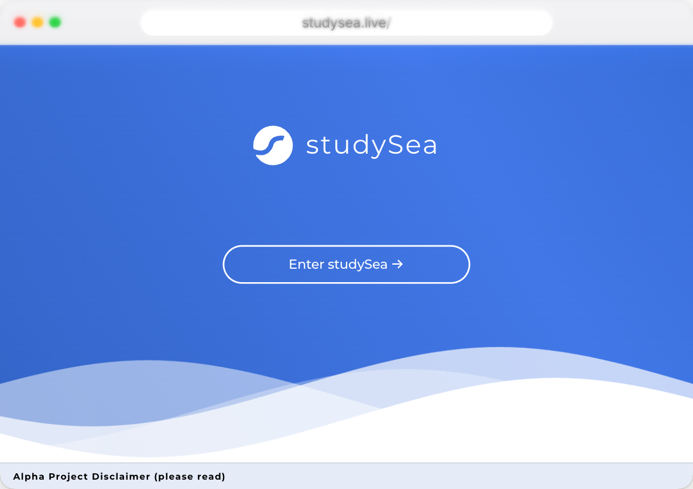
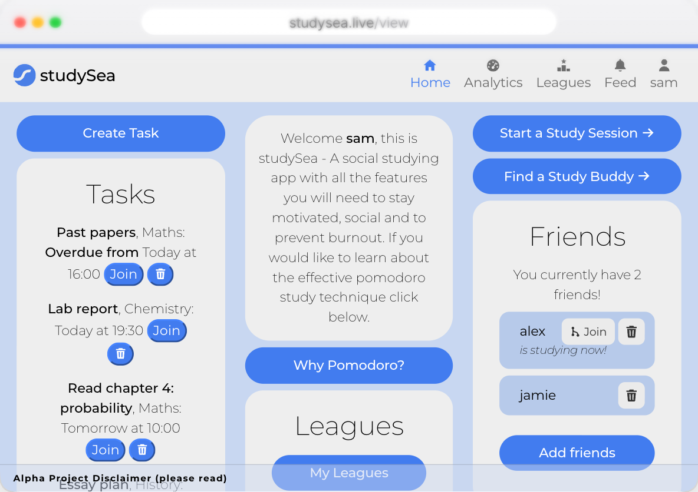
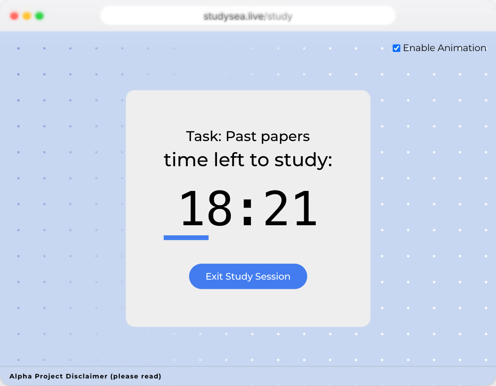
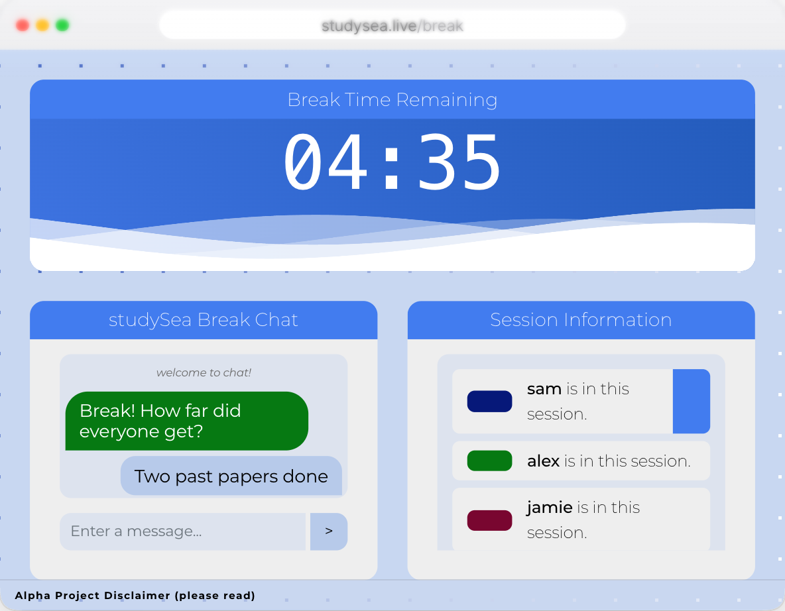
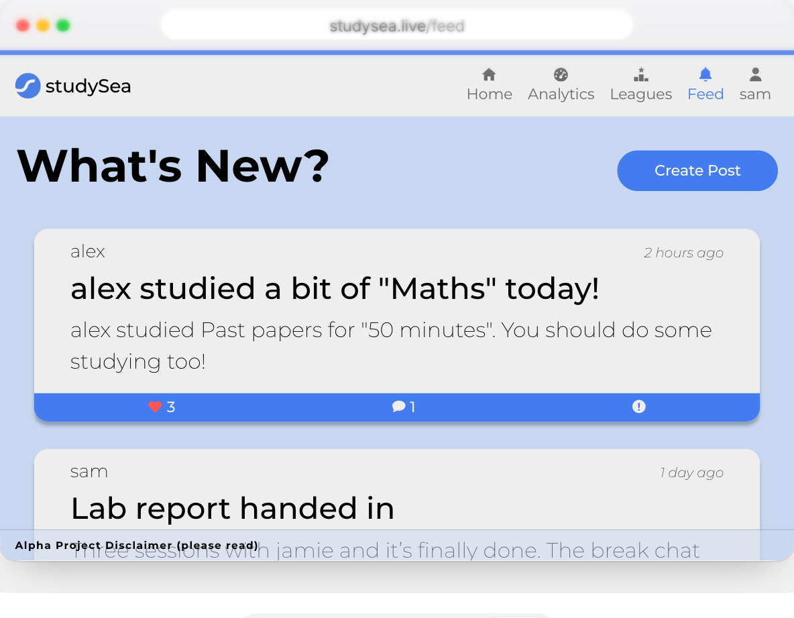

# StudySea

A study app built around the Pomodoro technique: study for a set block, say 25 minutes, take a short break, and repeat. The difference is that you do it with friends. Everyone in a session shares one timer, and the chat only opens on the breaks.

 

## What it does

- **Plan study sessions** as tasks, each with a subject, a start time, and how long the study blocks and breaks are.
- **Study together.** Start a session or join a friend's, and everyone counts down together. Join halfway through and you land on the same second as everyone else.
- **Chat on the breaks**, and only on the breaks.
- **Post on a feed** for your friends, with likes and comments. Finishing a session posts about it for you.
- **Compete in leagues** with friends, and see your study time broken down by subject.
- **Make it yours** with light, dark and high-contrast themes, and font settings.

 



## How it was made

StudySea was our second-year team project at the University of Birmingham, built by seven of us from February to May 2023. Each of us owned features from end to end. Mine were the feed, joining friends' study sessions, the settings page and keyboard shortcuts. I also looked after the database and its migrations, and made the shared Angular components the rest of the team built their pages from.

It's a [JHipster](https://www.jhipster.tech) app: Java and Spring Boot on the back end, Angular on the front, and PostgreSQL in production. The chat is a small separate Node.js server using Socket.IO, in [`src/main/node`](src/main/node).

It isn't online any more. The screenshots are its pages rebuilt for [my site](https://nour.page/projects/studysea/), with made-up people in them.

## Running it locally

You need Java 11 or newer (it runs on 17) and Node.js 18 or newer. In development it uses an H2 database in `target/`, so there's nothing else to set up.

```bash
# 1. The chat server, on port 3000
cd src/main/node && npm install && node main.js

# 2. The app, on port 8080 (in another terminal, from the project root)
./mvnw

# 3. Optional: some demo friends, tasks, posts and a league
node scripts/seed-demo-data.mjs
```

Then open http://localhost:8080 and sign in as `user` / `user` or `admin` / `admin`.
